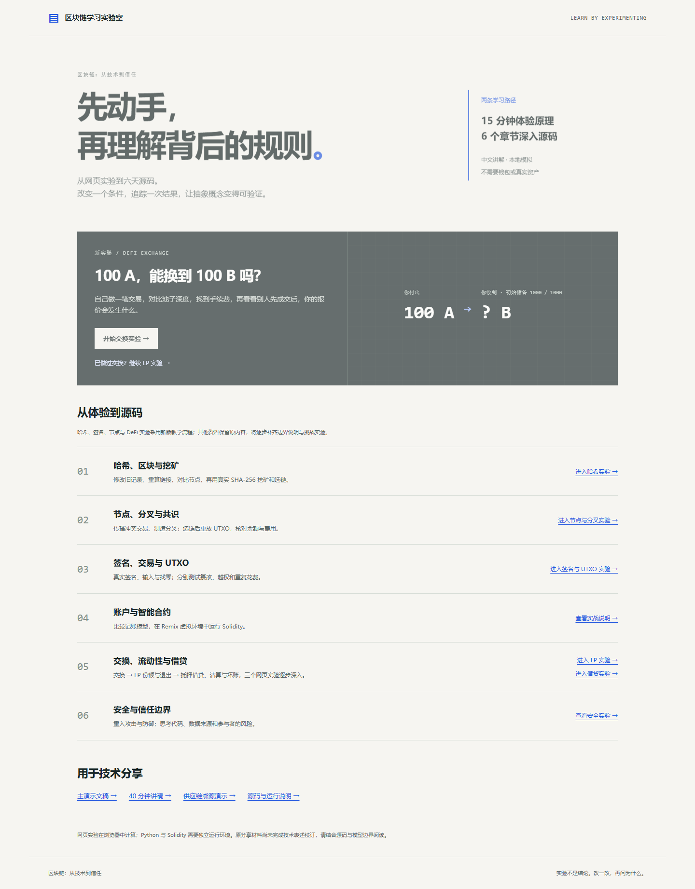
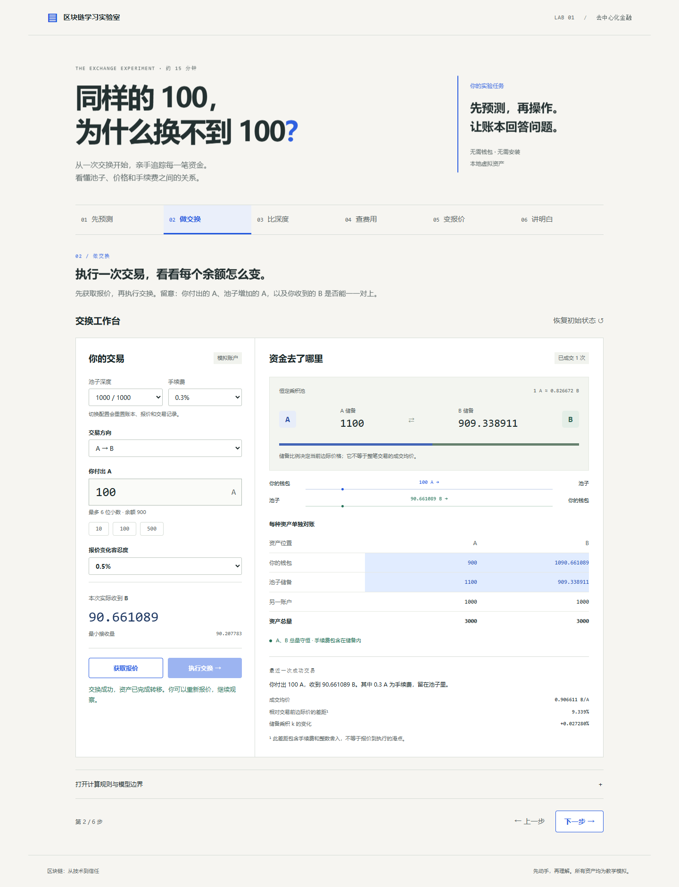

# 区块链学习实验室

**先在网页体验原理，再沿着六个章节深入源码。**

这套中文学习资料包含交互实验、六天实战源码、演示文稿和分享讲稿。新版用哈希、签名与分叉实验解释交易授权和共同历史，用可以对账的交换、LP 与借贷实验解释 DeFi 的资金与风险。

无需连接钱包，不处理真实资产；新版网页在浏览器本地计算。



## 从哪里开始

- 双击根目录 `index.html`，进入学习首页。
- 基础路径：打开 `03-演示文稿/chain-lab.html`，体验哈希、篡改、修复、挖矿和选链。
- 接着打开 `03-演示文稿/utxo-lab.html`，验证真实签名、找零、越权与重复花费。
- 再打开 `03-演示文稿/network-lab.html`，传播冲突交易、制造分叉、选链并重放 UTXO。
- 打开 `03-演示文稿/defi-exchange.html`，完成约 15 分钟的交换实验。
- 接着打开 `03-演示文稿/defi-liquidity.html`，比较提供流动性与直接持有。
- 再打开 `03-演示文稿/defi-lending.html`，观察抵押、价格、健康因子与清算坏账。
- 进入 `04-六天实战源码/day5-defi`，用 Python 与 Solidity 验证相同规则。
- 用 `03-演示文稿/blockchain-presentation.html` 和 `02-演讲稿` 组织技术分享。

公开体验地址：[区块链学习实验室](https://treeverge.github.io/blockchain-learning-lab/)。

## 新版 DeFi 实验

| 步骤   | 操作                   | 解释的问题                         |
| ------ | ---------------------- | ---------------------------------- |
| 先预测 | 猜测输入 100 A 的输出  | 初始储备比例为什么不等于成交均价？ |
| 做交换 | 报价、执行、逐资产对账 | 资金从哪里来，去了哪里？           |
| 比深度 | 从相同初始比例独立比较 | 交易规模与池子深度如何影响结果？   |
| 查费用 | 切换 0% / 0.3% 费率    | 手续费如何留在储备中？             |
| 变报价 | 让另一账户先交易       | 为什么执行时需要最小接收量？       |
| 讲明白 | 回答解释题并查看源码   | 能否用账本解释，而不只是记住公式？ |



初始储备 1000 A / 1000 B、输入 100 A、手续费 0.3%，输出为 **90.661089 B**。完整输入进入池子，交易后储备为 1100 A / 909.338911 B。

两种资产采用 6 位小数，浏览器使用 BigInt，Python 使用整数；Solidity 使用相同整数报价。最终输出向下取整，有手续费时实际储备乘积会增长。

## 六个章节

DeFi 网页学习路径已串联：交换 → LP → 借贷。借贷实验从真实模拟现金来源开始，允许补抵押和还款，并区分清算资格、实际清算和坏账。默认抵押 3 C、借款 180 B，在 75 B/C 时健康因子刚好为 1；价格降至 60 时，本教学规则清算后确认 8.571429 B 坏账。

| 章节  | 内容                        | 当前状态                                                                           |
| ----- | --------------------------- | ---------------------------------------------------------------------------------- |
| Day 1 | JavaScript 哈希、区块、挖矿 | 新增真实 SHA-256 哈希与选链网页；保留旧源码并注明模型差异                          |
| Day 2 | Python 多节点、共识、分叉   | 新增三节点签名交易、PoW 分叉与 UTXO 重组网页；保留原 Python 源码，依赖版本较旧     |
| Day 3 | 数字签名、UTXO、脚本        | 新增原生 ECDSA P-256 与 UTXO 网页；原 Python 使用 secp256k1，旧 RSA 页面保留作对照 |
| Day 4 | 账户模型、代币合约、存储    | 保留原实验                                                                         |
| Day 5 | AMM、DEX、借贷              | 交换、LP 与借贷网页实验；逐资产对账与清算坏账                                      |
| Day 6 | 重入攻击、防御、工具链      | 保留原实验，尚未完成本轮校订                                                       |

没有把所有章节标为完成或生产可用。原分享材料中的绝对化技术表述仍需逐步校订。每个教学模型都应与真实协议的实现边界区分。

## 本地运行与验证

新版实验网页可以直接双击；也可在项目根目录启动临时预览服务：

```powershell
python -m http.server 8765 --bind 127.0.0.1
```

访问 `http://127.0.0.1:8765/`。这只是开发预览，公开发布由 GitHub Pages 托管，不需要自己维护服务器。

Python 实验只使用标准库（建议 Python 3.8 或更高版本）：

```powershell
python -X utf8 "04-六天实战源码/day5-defi/01-amm-demo.py"
python -X utf8 "04-六天实战源码/day5-defi/03-lending-demo.py"
python -X utf8 -m unittest discover -s tests -p "test_*.py"
```

JavaScript 模型测试不需要安装依赖（Node.js 18 或更高版本）：

```powershell
node --test tests/amm.test.cjs tests/lp.test.cjs tests/lending.test.cjs tests/chain.test.cjs tests/utxo.test.cjs tests/network.test.cjs
```

Solidity 操作步骤与单位见 [Day 5 README](04-六天实战源码/day5-defi/README.md)。浏览器与 Solidity 的开发验证方法见 [验证说明](docs/verification.md)。

## 目录

```text
index.html                  学习首页
assets/css/lab.css          新版网页样式
assets/js/amm.js            可独立测试的整数交换模型
assets/js/exchange.js       教学步骤与交互
assets/js/lp.js             LP 份额、市场与套利账本
assets/js/liquidity.js      LP 网页交互
assets/js/lending.js        借贷、清算与坏账的整数模型
assets/js/borrow.js         借贷网页交互
assets/js/chain.js          哈希、证明与固定难度选链
assets/js/chain-lab.js      哈希网页交互与停止控制
assets/js/utxo.js           原生签名、交易验证与 UTXO 账本
assets/js/utxo-lab.js       签名、越权与双花网页实验
assets/js/network.js        节点接收、完整验链、选链与 UTXO 重放
assets/js/network-lab.js    交易传播、分叉与重组网页交互
03-演示文稿/                新版交换实验与原有演示
04-六天实战源码/            六个章节的本地实验
tests/                      计算、资金守恒、浏览器、合约验证
docs/                       设计、验证记录与截图
02-演讲稿/                  分享材料
01-产品介绍/                项目介绍与分享文案（保留原目录名）
```

## 后续改进

- 深化 LP 实验：部分退出、多用户与更复杂的市场情景。
- 深化借贷实验：利息、部分清算与预言机风险。
- 深化基础实验：在已串联的签名 / UTXO / 分叉重组之上探索传播延迟、确认深度与脚本条件。
- 校订共识、溯源和讲稿中的模型边界，逐章验证运行环境。

## 来源与许可

项目只维护 `index.html` 一个学习入口；重复的产品介绍页已删除，原商品上架文案已更新为项目介绍与分享文案。

项目新增代码与文档采用 [MIT](LICENSE)，上游代码保留自身许可和作者信息，具体见 [THIRD_PARTY.md](THIRD_PARTY.md)。原有第三方图片、商标和引用不由本项目授予 MIT 许可。

欢迎通过 Issue 提供错误算例、运行问题或教学建议。请附上操作步骤、预期结果与实际结果。
